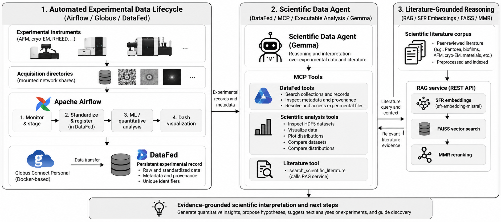

# Autonomous Scientific Data Framework

## 1. Overview

The Autonomous Scientific Data Framework is one integrated scientific workflow composed of three cooperating components:

1. **Automated Experimental Data Lifecycle** — Airflow, Globus Connect Personal, and DataFed move acquired experimental files through standardization, registration, and downstream processing.
2. **Scientific Data Agent** — an LLM-based agent uses MCP tools to find DataFed records and run executable scientific analyses on experimental data.
3. **Literature-Grounded Scientific Reasoning** — the Agent can call a literature retrieval service to bring external scientific evidence into interpretation and next-step reasoning.

The components are implemented in separate code directories and run in separate Python environments. Their integration is through DataFed records, MCP tools, and the RAG REST API.

## 2. Architecture



The overall scientific workflow is:

```text
Experiment → Airflow automation → DataFed persistent experimental record
→ MCP scientific agent → executable quantitative analysis
→ Gemma reasoning ↔ literature RAG
→ evidence-grounded interpretation → hypothesis / recommended next analysis or experiment
```

The Airflow data-lifecycle stages are logical stages, not a single strict DAG chain. The staging DAG triggers the DataFed ingestion workflow when it stages new files. ML/quantitative analysis and Dash visualization are separately orchestrated downstream workflows.

## 3. Automated Experimental Data Lifecycle

Experimental files originate in instrument acquisition directories on mounted network shares. Airflow provides persistent orchestration for the data lifecycle. The Airflow DAGs implement four logical stages:

1. **Monitoring and staging:** [`brave_staging_sync.py`](./airflow/airflow_home/dags/brave_staging_sync.py) scans its configured source directory, copies stable files into staging, and triggers the ingestion DAG when it copied files.
2. **Standardization and DataFed registration:** [`datafed_pipeline_working.py`](./airflow/airflow_home/dags/datafed_pipeline_working.py) runs [`production_airflow_upload_pipeline_gwy_airflow.py`](./airflow/cnms-qr-sample-tracking-main/production_airflow_upload_pipeline_gwy_airflow.py). The pipeline converts supported raw inputs to NeXus/HDF5, creates DataFed records for raw and standardized files, attaches metadata, and registers the files for Globus transfer using DataFed `dataCreate` and `dataPut`.
3. **ML and quantitative analysis:** [`segmentation_pipeline_dag.py`](./airflow/airflow_home/dags/segmentation_pipeline_dag.py) separately invokes [`segmentation_pipeline.py`](./airflow/cnms-qr-sample-tracking-main/segmentation_pipeline.py). The implemented YOLO pipeline processes supported `.gwy` and `.ibw` inputs and writes masks, overlays, and measurements to the staging filesystem.
4. **Dash visualization:** [`dash_pipeline_dag.py`](./airflow/airflow_home/dags/dash_pipeline_dag.py) separately launches the Dash application in [`dash_app.py`](./airflow/cnms-qr-sample-tracking-main/dash_app.py).

Globus Connect Personal is deployed using the included Dockerfile-based infrastructure in [`Globus-Personal-Docker/`](./airflow/Globus-Personal-Docker/). It provides the transfer layer used by DataFed uploads. DataFed holds the persistent experimental records and metadata used by the Agent.

The staging DAG triggers ingestion; the segmentation and Dash DAGs are separately scheduled. The four stages therefore describe the workflow responsibilities, not a guarantee that all four DAGs run as one sequential chain.

## 4. Scientific Data Agent

The Streamlit Agent in [`chat_app.py`](./agent/chat_app.py) uses Gemma through an OpenAI-compatible API and communicates with a local stdio MCP server in [`brave_server.py`](./agent/mcp_servers/brave_server.py). MCP tools provide the Agent with DataFed and scientific-analysis operations.

DataFed tools, implemented in [`datafed_tool.py`](./agent/tools/datafed_tool.py), search collections and records, inspect metadata and provenance, and resolve records to experimental files. Resolution first attempts to use a matching local Globus staging file and otherwise attempts retrieval through DataFed.

The MCP server exposes executable scientific-analysis tools implemented in [`scientific_tool.py`](./agent/tools/scientific_tool.py):

- Inspect HDF5 dataset paths, shapes, dimensions, and data types.
- Visualize selected scientific datasets.
- Plot value distributions and calculate descriptive statistics.
- Compare datasets using pixel-wise metrics when spatial correspondence is appropriate.
- Compare distributions for independent datasets.

These numerical operations are performed by the executable tools; Gemma selects tools and interprets the returned experimental results. The Agent prompt references `get_data`, but that helper is not currently exposed as an MCP tool.

## 5. Literature-Grounded Scientific Reasoning

When literature evidence is relevant, the MCP tool `search_scientific_literature` in [`brave_server.py`](./agent/mcp_servers/brave_server.py) calls the RAG REST service. The service in [`rag_service.py`](./rag/rag_service.py) uses SFR embeddings, FAISS retrieval, and maximal marginal relevance (MMR) reranking to return literature passages.

RAG supplies external scientific evidence for interpretation. It does not discover DataFed records and does not calculate experimental measurements. The Agent combines tool-produced experimental observations with retrieved literature evidence while distinguishing observations, interpretation, and proposed next steps.

## 6. End-to-End Scientific Workflow

1. An instrument writes experimental files to an acquisition directory on a mounted share.
2. Airflow stages stable files and triggers the ingestion workflow.
3. The ingestion workflow standardizes supported raw files and registers raw and standardized records and metadata in DataFed through Globus.
4. Separately scheduled Airflow workflows run supported ML/quantitative processing and launch Dash visualization.
5. A scientist asks the Agent a question. Gemma selects MCP tools to find DataFed records, inspect metadata/provenance, resolve files, and execute relevant analyses.
6. When appropriate, Gemma calls `search_scientific_literature`; the RAG service returns literature evidence for the Agent to use in interpretation.
7. The Agent reports evidence-grounded interpretation and, where justified, hypotheses or recommended next analyses or experiments.

## 7. Evaluation

The repository includes component-level validation and evaluation materials:

- The Airflow component documents ingestion, standardization, and DataFed registration workflows.
- The Agent includes tool and DataFed-related test scripts.
- The RAG component includes retrieval and ablation evaluation scripts and recorded results. Its README reports a 50-question benchmark with originating-paper Hit@3 of 86%, semantically relevant passage success@3 of 84%, and success@5 of 90%.

These component results do not constitute a clean-machine end-to-end validation of the complete Airflow → DataFed → MCP → RAG workflow.

## 8. Repository Structure

```text
.
├── README.md
├── architecture/
│   ├── README.md
│   └── scientific_workflow.png
├── components/                 # Component notes
├── evaluation/                 # Framework evaluation notes
├── airflow/                    # DAGs, ingestion, Globus infrastructure
├── agent/                      # Streamlit Agent, MCP server and tools
└── rag/                        # Literature KB builder, REST service and evaluation
```

## 9. Deployment-Specific Dependencies

The following values and resources are deployment-specific configuration requirements, not failures of the component architecture. The checked-in copies include settings from a particular deployment; those values must be adapted before use elsewhere.

- **Airflow and mounted data:** Airflow paths and DAGs refer to `/home/cloud/...`; the staging workflow expects a mounted acquisition directory and a writable Globus staging location. Persistent service setup is described in the Airflow component README.
- **Airflow runtime configuration:** the ingestion and staging workflows require `config.json` and `project_config.json` with site-specific DataFed context/repository, Globus endpoint and path mapping, watched/staging paths, metadata, and destination collection settings. These runtime files are not included.
- **DataFed and Globus:** users must configure DataFed authentication, a valid Globus Connect Personal endpoint and collection, and accessible transfer paths. Example DataFed IDs and the default context `p/cnms` in code are not universal deployment values.
- **Agent and Gemma:** the active Agent uses model `gemma4:12b` and a deployment-specific LLM URL. Configure the appropriate model service, URL, credentials if required, and writable paths for chat history and plots.
- **Segmentation model:** the configured YOLO weights path is `/home/cloud/microflow_sidpy_nomad_server/best_AFM.pt`. Supply the appropriate model weights and configure their location for the deployment.
- **RAG corpus and service:** knowledge-base construction requires a literature corpus and manifest. Runtime retrieval requires the generated FAISS index and chunk metadata, the SFR embedding model/service, and a reachable RAG REST service.
- **Current checked-in service addresses:** the Agent points to `10.64.194.121:11434` for the LLM and `10.64.194.121:8003` for RAG. The RAG builder/service points to `10.123.23.27:8001` for embeddings. These internal addresses are deployment-specific.
- **Environments:** install Airflow, Agent, and RAG dependencies in their respective separate Python environments using [`airflow/requirements.txt`](./airflow/requirements.txt), [`agent/requirements.txt`](./agent/requirements.txt), and [`rag/requirements.txt`](./rag/requirements.txt). Their package pins differ because the components are run separately; those differences are not inherently dependency conflicts. The Agent requirements file may need explicit additions for imported packages such as `requests` and SciPy.

## 10. Known Limitations

- RAG HTTP error responses can currently be returned as ordinary MCP tool content and interpreted by the Agent’s evidence gate as successful evidence retrieval.
- The Agent prompt references `get_data`, but it is not currently exposed as an MCP tool.
- The DataFed `dataGet` fallback has not been fully validated to place the retrieved file in the expected local destination.
- No clean-machine end-to-end integration test currently validates the complete Airflow → DataFed → MCP → RAG workflow.
- Segmentation-derived outputs are retained locally and are not registered back into DataFed by the current segmentation pipeline.
- The active uploader creates separate raw and standardized DataFed records but does not explicitly add a provenance relationship between them.

## 11. Reproducibility

Reproducing the workflow requires deploying and configuring each component in its own environment, providing the deployment-specific files and services listed above, and making the mounted source and Globus staging paths available to the Airflow host. The RAG knowledge base must be built from an available corpus before the RAG service can load its index.

The component READMEs provide additional setup details: [`airflow/README.md`](./airflow/README.md), [`agent/README.md`](./agent/README.md), and [`rag/README.md`](./rag/README.md). Their instructions include original-deployment assumptions, so review and adapt paths, endpoints, authentication, and collection configuration for the target environment.
